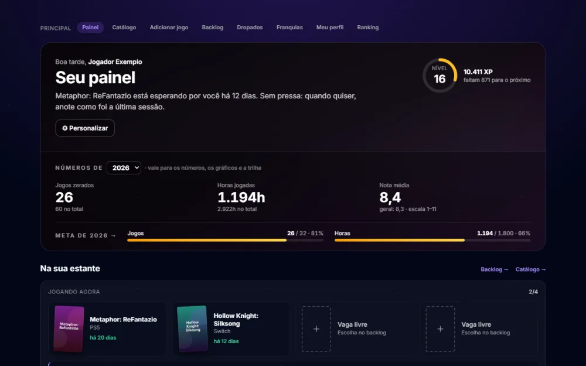
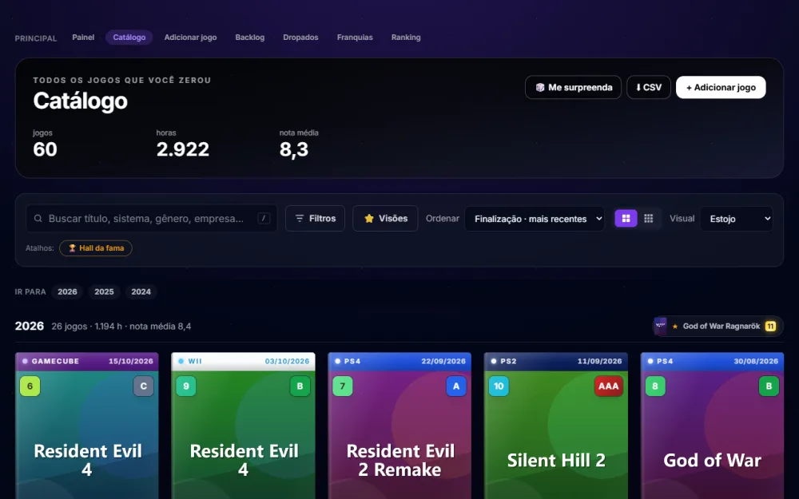
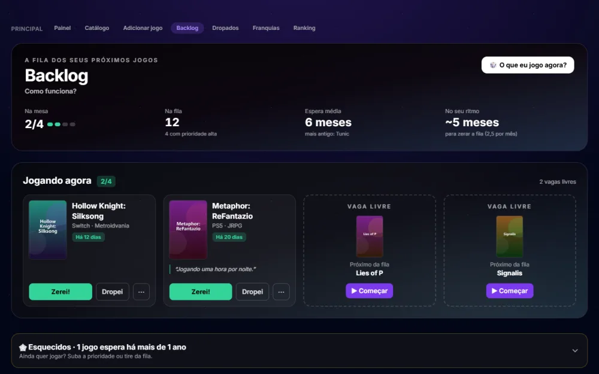

# MyGameList

Programa para Windows que guarda os jogos que você zerou, com análises e gamificação. Funciona sem internet:
os dados ficam no próprio computador.

## O que faz

- **Catálogo** dos jogos zerados, com nota (1 a 11), dificuldade, tempo, capas, diário e screenshots.
- **Backlog**, dropados e **franquias** com progresso.
- **GOTY**, retrospectiva, best of, estatísticas, timeline, mapa de calor, metas e livro em PDF.
- Vários **usuários** no mesmo computador, cada um com a sua imagem, ranking, XP e níveis.
- 20 temas, menu em tela cheia e atalhos de teclado.

| Catálogo | Backlog |
|---|---|
|  |  |

*As imagens usam jogos de exemplo.*

> **Atenção:** é um programa local e **não tem senha**. Não publique o app na internet: qualquer pessoa entraria em
> qualquer usuário.

## Usar

Precisa do Windows 10 ou 11 com o Microsoft Edge. Baixe o `.zip` em **Releases**, extraia e abra o `MyGameList.exe`.
Como o programa não tem assinatura digital, o Windows pode avisar: "Mais informações" > "Executar assim mesmo".
Mais detalhes em [LEIA-ME.txt](LEIA-ME.txt).

Os dados ficam em `%LOCALAPPDATA%\MyGameList`. Para backup, feche o programa e copie essa pasta.

## Montar a partir do código

1. Tenha um **PHP 8.2 para Windows** (x64, Thread Safe), do [site oficial](https://windows.php.net/download/) ou do XAMPP.
2. Rode `preparar-php.bat "C:\caminho\do\php"` (sem caminho, usa `C:\xampp\php`).
3. Rode `lancador\compilar.bat`. Ele usa o compilador C# que já vem no Windows.
4. Abra o `MyGameList.exe`. O banco é criado na primeira vez.

Só se mudar classes de estilo nas telas: coloque o
[tailwindcss.exe 3.4.16](https://github.com/tailwindlabs/tailwindcss/releases/tag/v3.4.16) em `app\tools\` e rode
`app\bin\build_css.bat`.

## Como é feito

PHP (sem framework) com SQLite, Alpine.js e Tailwind CSS. O `MyGameList.exe` (`lancador/Lancador.cs`) liga o servidor
embutido do PHP apenas em `127.0.0.1`, abre uma janela do Edge em modo aplicativo e encerra tudo ao fechar.

| Pasta | Conteúdo |
|---|---|
| `app/` | telas, regras, rotas e esquema do banco (`database/schema`) |
| `lancador/` | código do executável e `php.ini` |
| `ferramentas/` | criar atalho; importar de uma instalação antiga em XAMPP/MySQL |
| `licencas/` | licenças dos componentes de terceiros |

Notas de projeto e decisões: [app/BRIEFING.md](app/BRIEFING.md).
